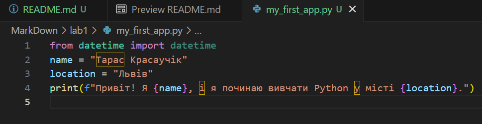
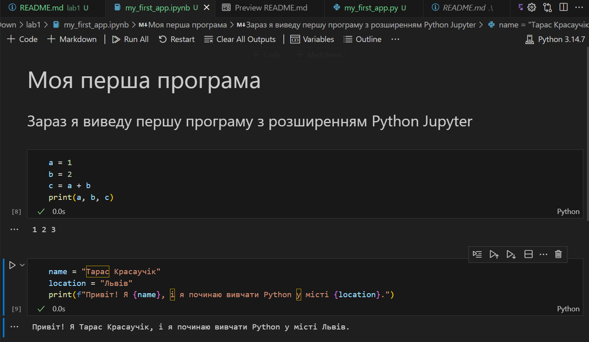
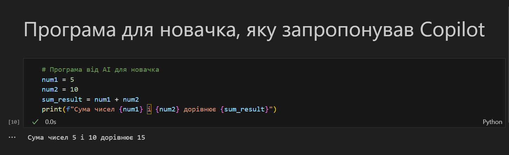

# Звіт до роботи
## Тема: Вступні заняття: налаштування середовища, початок роботи з Python та Markdown
### Мета роботи: налаштувати середовище роботи у VS Code, створити репозиторій GitHub та налаштувати інтеграцію з ним, написати першу програму на Python і створити звіт із використанням форматування Markdown.

---
### Виконання роботи
* Результати виконання завдань:
    1. Створив папку `lab1` у репозиторії та налаштував середовище VS Code з розширеннями Python, Jupyter та Copilot.
    2. Створив програму на Python у файлі [my_first_app.py](./my_first_app.py), яка виводить привітання,використовуючи змінні.

        Скрін програми:
    
    3. Програма вивела значення:
       ```text
       Привіт! Я Тарас Красаучік, і я починаю вивчати Python у місті Львів.
       ```
    4. Створив файл [my_first_app.ipynb](./my_first_app.ipynb), у якому виконав код у комірці та додав опис у комірці формату Markdown ("# Моя перша програма").
    
    5. Запитали в AI (Copilot) приклад першої програми для новачка. AI запропонував таку просту програму для додавання двох чисел:
       ```python
       # Програма від AI для новачка
       num1 = 5
       num2 = 10
       sum_result = num1 + num2
       print(f"Сума чисел {num1} і {num2} дорівнює {sum_result}")
       ```
       
       RESULT:
       
    6. Отримано наступні результати: всі створені файли (`.py`, `.ipynb`, `.md`, `image.png`) зафіксовано комітом та відправлено в репозиторій GitHub через Source Control.

---
### Висновок:

- **Що зроблено в роботі:** Встановлено необхідні розширення VS Code, створено першу програму на Python у файлі `.py` та в інтерактивному ноутбуці `.ipynb`, запропоновано приклад коду від AI та збережено всі файли в папці lab1 репозиторію Markdown.
- **Чи досягнуто мети роботи:** Так, мету роботи повністю досягнуто.
- **Які нові знання отримано:** Навчилися використовувати змінні, і f-рядки у Python, працювати з комірками Jupyter Notebook та використовувати GitHub у VS Code.
- **Чи вдалось відповісти на всі питання задані в ході роботи:** Так, вроді все чотко.
- **Чи вдалося виконати всі завдання:** Усі обов'язкові та додаткові завдання виконано у повному обсязі.
- **Чи виникли складності у виконанні завдання:** Складнощів не виникли, все працювало коректно після вибору правильного інтерпретатора Python.
- **Чи подобається такий формат здачі роботи (Feedback):** Так, формат звіту в Markdown дуже зручний, оскільки дає змогу зберігати код в одному місці на GitHub, особливо з використанням розширення Jupyter.
- **Побажання для покращення (Suggestions):** Все люкс! Дякую за увагу!

---