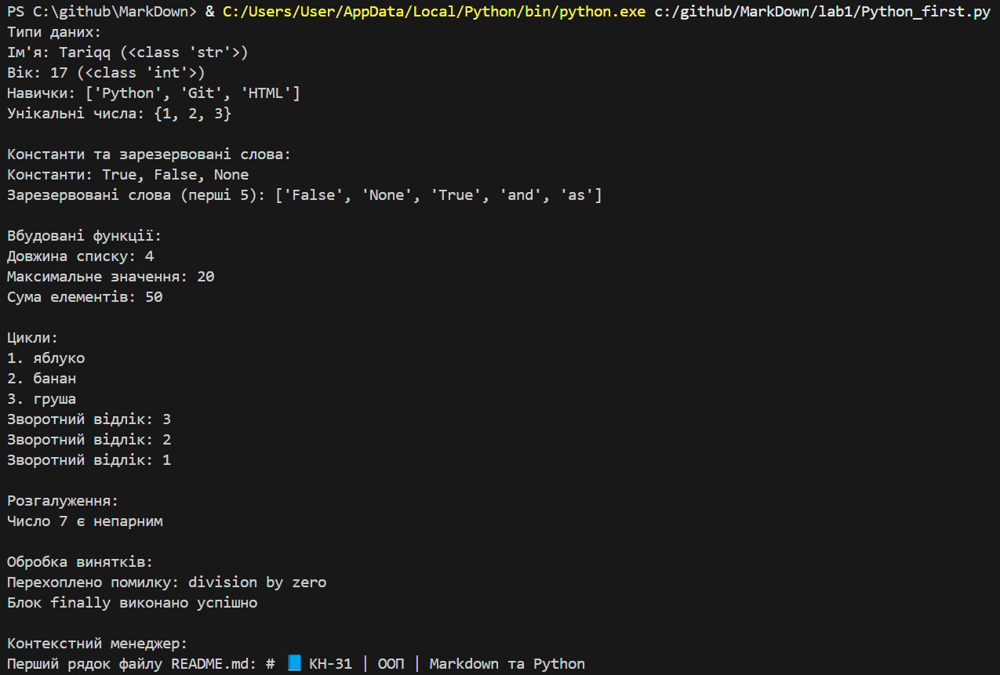

# РОБОТА №1: Основи програмування на Python

## Мета роботи: навчитися застосовувати основні конструкції мови Python, виконати всі приклади та за допомогою AI створити власні приклади, які демонструють особливості конструкцій мови Python

---
### Виконання роботи
* Результати виконання завдань (1–8):
    1. **Типи даних:** Створили файл `main.py` та розробили базові приклади типів даних: `str`, `int`, `float`, `list`, `dict`, `tuple`, `set`. Програма вивела значення змінних та їхні типи.
    2. **Вбудовані константи та зарезервовані слова:** Вивели константи `True`, `False`, `None` та список зарезервованих слів Python.
    3. **Вбудовані функції:** Протестували функції `len()`, `min()`, `max()`, `sum()` та `abs()`.
    4. **Цикли:** Реалізували цикл `for` з функцією `enumerate()` для обходу елементів списку, а також цикл `while`.
    5. **Розгалуження:** Написали перевірку парності числа за допомогою конструкції `if-elif-else`.
    6. **Конструкція `try-except-finally`:** Обробили помилку ділення на нуль (`ZeroDivisionError`).
    7. **Контекстний менеджер `with`:** Реалізували безпечне читання файлу `README.md`.
    8. **Лямбда-функції:** Створили анонімну функцію для обчислення квадрата числа та форматування строки.

* Посилання на файл з програмою: [`Python_first.py`](./Python_first.py)

* Вставлений код програми `Python_first.py`:
```python
# 1. Типи даних
name = "Tariqq"
age = 17
height = 1.73
skills = ["Python", "Git", "HTML"]
student_info = {"name": name, "age": age}
coordinates = (50.45, 30.52)
unique_numbers = {1, 2, 3, 3, 2}

print("Типи даних:")
print(f"Ім'я: {name} ({type(name)})")
print(f"Вік: {age} ({type(age)})")
print(f"Навички: {skills}")
print(f"Унікальні числа: {unique_numbers}\n")

# 2. Вбудовані константи та зарезервовані слова
print("Константи та зарезервовані слова:")
print(f"Константи: {True}, {False}, {None}")
import keyword
print(f"Зарезервовані слова (перші 5): {keyword.kwlist[:5]}\n")

# 3. Вбудовані функції
numbers = [10, 5, 20, 15]
print("Вбудовані функції:")
print(f"Довжина списку: {len(numbers)}")
print(f"Максимальне значення: {max(numbers)}")
print(f"Сума елементів: {sum(numbers)}\n")

# 4. Цикли
print("Цикли:")
fruits = ["яблуко", "банан", "груша"]
for idx, fruit in enumerate(fruits, 1):
    print(f"{idx}. {fruit}")

count = 3
while count > 0:
    print(f"Зворотний відлік: {count}")
    count -= 1
print()

# 5. Розгалуження
print("Розгалуження:")
num = 7
if num % 2 == 0:
    print(f"Число {num} є парним")
else:
    print(f"Число {num} є непарним\n")

# 6. Обробка винятків try-except-finally
print("Обробка винятків:")
try:
    result = 10 / 0
except ZeroDivisionError as e:
    print(f"Перехоплено помилку: {e}")
finally:
    print("Блок finally виконано успішно\n")

# 7. Контекстний менеджер with
print("Контекстний менеджер:")
try:
    with open("README.md", "r", encoding="utf-8") as f:
        first_line = f.readline().strip()
        print(f"Перший рядок файлу README.md: {first_line}")
except FileNotFoundError:
    print("Файл README.md не знайдено, але з'єднання закрито коректно.")
print()

# 8. Лямбда-функції
print("Лямбда-функції:")
square = lambda x: x ** 2
greet = lambda user: f"Привіт, {user}!"

print(f"Квадрат числа 5: {square(5)}")
print(greet("Tariqq"))
```

* Скріншот виконання програми:



---
### Висновок:
> Відповіді на підсумкові запитання:

- **Що зроблено в роботі:** Я опрацьював основні синтаксичні конструкції мови Python (змінні, типи даних, константи, вбудовані функції, цикли, умовні оператори, обробку помилок, контекстний менеджер `with` та лямбда-функції). Написав відповідний програмний код у файлі `Python_first.py`.
- **Чи досягнуто мети роботи:** Так, мету роботи повністю досягнуто — я здобув практичні навички застосування базових конструкцій Python.
- **Які нові знання отримано:** Навчився практично використовувати контекстний менеджер `with` для безпечної роботи з файлами, обробляти винятки за допомогою `try-except-finally` та створювати анонімні лямбда-функції.
- **Чи вдалось відповісти на всі питання задані в ході роботи:** Так, точно!
- **Чи вдалося виконати всі завдання:** Так, усі 8 пунктів практичної роботи я виконав.
- **Чи виникли складності у виконанні завдання:** Складнощі виникли тоді, коли мені потрібно було заново налаштовувати зв'язок між VScode n GitHub, але через величезні мучення, кров'ю і потом я все ж таки сконфігурував комітти і тепер все синхронізується чудесно! А сама робота виявилась дуже простою і зрозумілою.
- **Feedback(`bout MarkDown):** Так, насправді, якщо я досконало вивчу формат звітування Markdown, це буде найзручніший формат подання любої інформації. Він мені дуже зайшов!
- **Suggestions:** Бажаю лише поменше замінувань!)